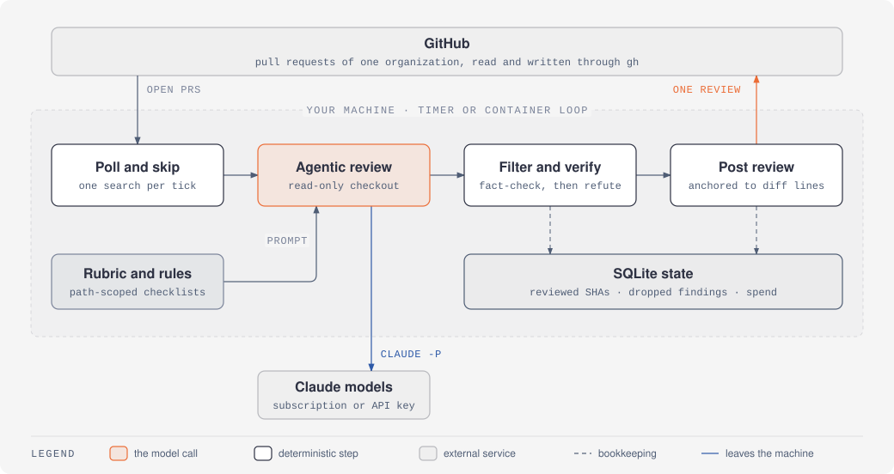
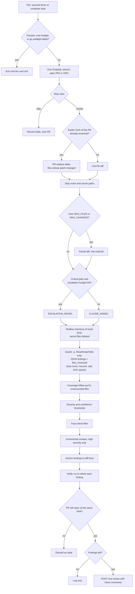
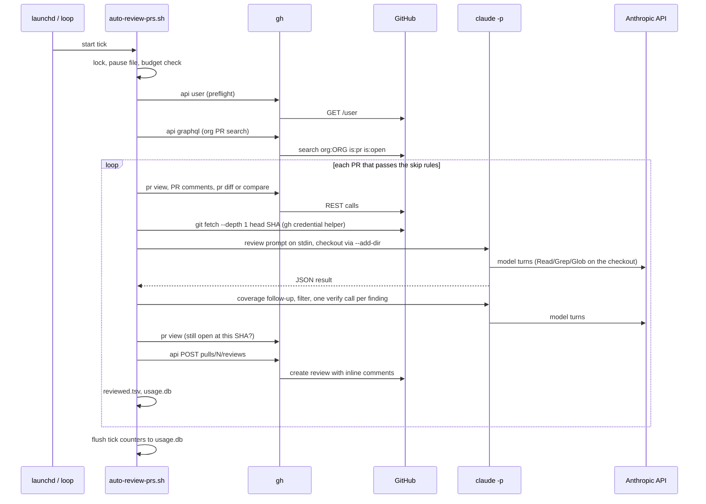
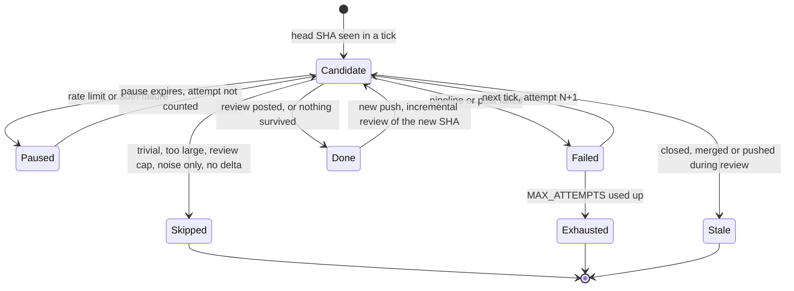

<div align="center">

# claude-pr-reviewer

Automated pull request review for a GitHub organization, run on your own machine with the Claude Code CLI.

[](LICENSE)
[](bin/)
[](#limitations)
[](Dockerfile)

</div>

<picture>
  <source media="(prefers-color-scheme: dark)" srcset="docs/assets/architecture-dark.svg">
  
</picture>

claude-pr-reviewer polls the open pull requests of one GitHub organization,
reviews each new head commit with `claude -p` against a read-only checkout of
the PR, runs the findings through deterministic and model-based filters, and
posts the survivors as one inline review under your own `gh` identity. It is a
set of bash scripts with SQLite for bookkeeping, a launchd timer on macOS or a
container loop on Linux. There is no server, no webhook and no GitHub App.

## Table of Contents

- [Getting Started](#getting-started)
  - [1. macOS with launchd on a Claude subscription](#1-macos-with-launchd-on-a-claude-subscription)
  - [2. Docker with an API key](#2-docker-with-an-api-key)
  - [3. One-off run and dry runs](#3-one-off-run-and-dry-runs)
- [Why use it](#why-use-it)
- [Features](#features)
- [How It Works](#how-it-works)
- [Configuration](#configuration)
- [Feedback and eval loop](#feedback-and-eval-loop)
- [Data Privacy](#data-privacy)
- [Limitations](#limitations)
- [Contributing](#contributing)
- [License](#license)

## Getting Started

Requirements: bash 4 or newer (`declare -A`, `mapfile`; macOS ships 3.2, so
install it with Homebrew), [`gh`](https://cli.github.com), `jq`, `sqlite3`,
`git`, and the [Claude Code CLI](https://code.claude.com/docs/en/setup). The
GitHub account you authenticate `gh` with is the one the reviews are posted
as, and it needs read access to the org's repositories.

### 1. macOS with launchd on a Claude subscription

```bash
brew install bash gh jq sqlite git
curl -fsSL https://claude.ai/install.sh | bash    # or: brew install --cask claude-code
claude                                            # log in once with your subscription
gh auth login

git clone <this repository> claude-pr-reviewer && cd claude-pr-reviewer
./install.sh                                      # scripts to ~/.local/bin, config to ~/.config/auto-pr-review
$EDITOR ~/.config/auto-pr-review/config.sh        # set ORG at least
```

`install.sh` never overwrites an existing config file. On macOS it renders the
two plists into `~/Library/LaunchAgents/` (as `<name>.plist.new` when a plist
of that name already exists) and prints the `launchctl bootstrap` commands; it
does not run them. Try a dry run first (see
[3](#3-one-off-run-and-dry-runs)), then load the agents:

```bash
launchctl bootstrap gui/$(id -u) ~/Library/LaunchAgents/com.example.auto-pr-review.plist
launchctl bootstrap gui/$(id -u) ~/Library/LaunchAgents/com.example.auto-pr-review-digest.plist
```

The tick runs every 300 seconds; the digest runs Mondays at 09:00. launchd
does not read your shell profile, so if you want an API key or a token instead
of the keychain logins, put it in `~/.config/auto-pr-review/env`
(template: [`config/env.example`](config/env.example), `chmod 600`).

### 2. Docker with an API key

```bash
cp .env.example .env              # set ANTHROPIC_API_KEY (or CLAUDE_CODE_OAUTH_TOKEN) and GH_TOKEN
mkdir -p docker-data/config docker-data/state
docker compose run --rm reviewer true          # first start seeds docker-data/config
$EDITOR docker-data/config/config.sh           # set ORG
docker compose run --rm -e DRY_RUN=1 reviewer auto-review-prs.sh
docker compose up -d                           # tick every INTERVAL_SECONDS (default 300)
tail -f docker-data/state/run.log
```

The image is Debian slim with the Claude Code native installer (pinned to
2.1.322, the version the read restriction below was tested with), runs as a
non-root user, and never overwrites files in the mounted config directory. On
Linux, build with `HOST_UID=$(id -u) HOST_GID=$(id -g) docker compose build` so
the container user owns the bind-mounted directories. For a subscription instead of an API
key, generate a token with `claude setup-token` on a machine with a browser and
set `CLAUDE_CODE_OAUTH_TOKEN`.

The Docker path has been tested up to dry runs: the image builds, the loop
starts, a tick runs and exits cleanly when `gh` is not authenticated, and the
pipeline's parsing functions produce byte-identical output on macOS and in the
container. A full review with a real key inside the container has not been run
yet.

### 3. One-off run and dry runs

`install.sh` puts the scripts in `~/.local/bin` (or `$PREFIX`); that directory
must be on your `PATH` for the commands below, or call them by full path.

```bash
DRY_RUN=1 auto-review-prs.sh        # list the PRs a tick would review; no Claude calls
NO_POST=1 auto-review-prs.sh --pr https://github.com/your-org/your-repo/pull/123
cat ~/.local/state/auto-pr-review/last-payload.json
auto-review-prs.sh --pr https://github.com/your-org/your-repo/pull/123   # review and post one PR
```

- `DRY_RUN=1` runs the skip rules and logs `review ... DRY_RUN, skipping claude call`
  for each candidate. Deterministic skips (trivial, too large, review cap) are
  still recorded.
- `NO_POST=1` runs the full pipeline and writes the review payload to
  `last-payload.json` instead of posting. That head SHA is then recorded as
  reviewed, so the scheduled tick will not post it later; delete its row from
  `reviewed.tsv` to review it again. Nothing is written when no finding survives.
- `--pr URL` processes only that PR, with the same skip rules (your own PRs,
  drafts, an already-handled head SHA) and the same state files. It prints
  `done: ...` and exits 0 when the review ran, or `not reviewed: <reason>` on
  stderr and exits 1 when nothing was done (lock held, paused, budget reached,
  a skip rule, PR not open, or a failed review).

Everything is logged to `~/.local/state/auto-pr-review/run.log`.

## Why use it

Hosted review bots run on someone else's server with their API key and post as
their GitHub App. This one runs where you run it:

- **Your Claude account.** It shells out to `claude -p`, so it works on a
  Claude subscription (no API key needed) or on an `ANTHROPIC_API_KEY`, with
  whichever models you configure.
- **Your GitHub identity.** Reviews are posted with `gh` as you. There is no
  app to install in the org and nothing to approve beyond what your account
  can already do.
- **No infrastructure.** No webhook endpoint, no database server, no queue. A
  timer, four scripts, a TSV file and a SQLite database.
- **Measured, not guessed.** Every model call, every pipeline stage and every
  dropped finding is recorded, and the eval harness replays labelled PRs
  through the same code path the live tick uses. [docs/DESIGN.md](docs/DESIGN.md)
  has the numbers that shaped the pipeline.

## Features

| Feature | What it does | Where |
|---|---|---|
| Org-wide polling | One GraphQL search for every open PR in `ORG` per tick (first 100). | `SEARCH_Q` |
| Skip rules | Archived repos, `SKIP_REPOS`, your own PRs and `SKIP_AUTHORS`, drafts, already-handled head SHAs, trivial PRs, oversized PRs, a per-PR review cap, exhausted attempts. | main loop |
| Agentic review in context | Shallow checkout of the exact head SHA; Claude reads changed files, callers and tests with `Read`/`Grep`/`Glob` only, confined to the checkout. It never runs PR code. | `checkout_pr_head`, `review_pipeline` |
| Injection hardening | Claude runs from an empty temp directory, so the PR's own `CLAUDE.md`, `.claude/` and `.mcp.json` are not loaded. Author-controlled text is wrapped in untrusted-data markers that the PR cannot close, and goes in on stdin, never on the command line. | `NEUTRAL_CWD`, `sanitize_untrusted`, `claude_run` |
| Secret-path exclusion | `.env*` (except example/sample/template), `.npmrc`, `.pypirc`, `.netrc`, SSH keys are removed from the diff and deleted from the checkout. | `is_secret_path` |
| Noise stripping | Lockfiles, minified files, source maps, generated code, snapshots, `dist/`, `build/`, `.next/`, `node_modules/` are dropped; migrations are kept. | `strip_noise_from_diff` |
| Incremental re-review | On a new push, only files whose PR-relative patch changed are reviewed, and only findings at `INCREMENTAL_MIN_SEVERITY` or above are posted. A merge from the base branch is skipped. | `incremental_diff` |
| Partial review | PRs over `MAX_FILES`/`MAX_CHANGES` get a risk-ordered subset (critical paths first, then largest source files, tests and docs left out), and the prompt tells the reviewer to say so in its summary. | `reduce_diff_for_partial` |
| Model escalation | Diffs touching `CRITICAL_PATHS_REGEX` (auth, payments, migrations...) go to `ESCALATION_MODEL` until its monthly sub-budget is used up. | `choose_model` |
| Failure handling | Max-turns runs are resumed for one turn to salvage the JSON; rate-limit and auth failures pause all ticks without burning an attempt; other failures retry once, then defer; the last attempt falls back to `FALLBACK_MODEL`. | `run_with_fallback_and_log` |
| Coverage contract | The reviewer must account for every reviewable file; missing ones get one resumed follow-up call, and files still missing are named in the summary. | `ensure_coverage` |
| Thresholds and fact-check filter | Severity/confidence thresholds in `jq`, then a cheap model may only remove duplicates, pure style, or findings the diff provably contradicts, with a quoted line as evidence. Fails open. | `threshold_findings`, `filter_findings` |
| Snippet anchoring | Each finding quotes the code it is about; the harness finds that text in the diff and anchors the comment there (multi-line ranges supported), so GitHub never rejects the review for a bad line. | `anchor_findings` |
| Adversarial verification | One read-only call per finding that tries to refute it against the checkout. Fails open. | `verify_findings` |
| Posting | One `COMMENT` review with inline comments, a security tally for severity 4+ security findings, a stale-head check before posting, a body-only fallback, and no post at all when nothing survives. | `post_inline_review` |
| Path-scoped checklists | Extra checklists (GitHub workflows, migrations, i18n, server actions...) are added to the prompt only when a matching file is in the diff. | `rules_block_for`, `config/rules/` |
| Per-repo guidance | `repos/<owner>/<repo>.md` is appended to the system prompt for that repo. | `build_system_prompt` |
| Bookkeeping | Per-call tokens, turns, cost and stop reason; per-stage finding counts; every dropped finding with its reason; monthly budget guard; PID lock; log rotation. | `usage.db`, `config/schema.sql` |

<details>
<summary>Example output (illustrative; written for this README about made-up code)</summary>

Review body:

```markdown
**needs-changes** — Invoice route reads any invoice by id with the service-role client.

**Security: 1 finding(s) at severity >= 4. Please triage these explicitly (fix, or reply why not).**

<!-- claude-pr-reviewer head_sha=0123456789abcdef0123456789abcdef01234567 model=claude-sonnet-5 -->
```

Inline comment on `app/api/invoices/[id]/route.ts`, lines 14-15:

```markdown
**[security sev=5 conf=4]** `GET` loads the invoice with `createAdminClient()` using
`params.id` straight from the URL, and the only check above it is that *some* user is
signed in. Any signed-in user can read any invoice by guessing ids. Either query with
the request-scoped client so row-level security applies, or check
`invoice.account_id === session.accountId` before returning it.
```

</details>

## How It Works

### Pipeline



### One tick



### A PR's lifecycle across head SHAs

State is keyed by `(repo, PR, head SHA)` in `reviewed.tsv`. A new push creates a
new key; the last `done` SHA becomes the base for the incremental delta.



## Configuration

All knobs live in `~/.config/auto-pr-review/config.sh`
([`config/config.example.sh`](config/config.example.sh)). Environment
variables only override knobs that `config.sh` does not set.

<details>
<summary>Main knobs</summary>

| Knob | Default | Meaning |
|---|---|---|
| `ORG` | (required) | GitHub organization to poll. |
| `SKIP_REPOS` | empty | Space-separated `owner/repo` names to ignore. |
| `SKIP_AUTHORS` | `dependabot renovate github-actions` and their `[bot]` forms | Logins to ignore in addition to your own. The org search reports app logins without the `[bot]` suffix, so list both forms. |
| `SKIP_DRAFTS` | `1` | Ignore draft PRs. |
| `CLAUDE_MODEL` | `claude-sonnet-5` | Review and verify model. |
| `ESCALATION_MODEL` | `claude-opus-5-5` | Used when the diff touches `CRITICAL_PATHS_REGEX`. |
| `ESCALATION_BUDGET_USD` | `15` | Monthly cap for the escalation model family. |
| `CRITICAL_PATHS_REGEX` | `auth\|payment\|billing\|...\|migrat` | Paths that trigger escalation and are kept first in partial reviews. |
| `FILTER_MODEL` | `claude-haiku-5-5` | Fact-check filter. |
| `FALLBACK_MODEL` | `claude-haiku-5-5` | Last resort on the final attempt. |
| `CLAUDE_EFFORT` | `high` | Passed as `--effort` on every call. |
| `MAX_TURNS` | `30` | Tool-call budget of the review call. |
| `VERIFY_MAX_TURNS` | `10` | Per-finding verification budget. |
| `COVERAGE_FOLLOWUP` / `COVERAGE_MAX_TURNS` | `1` / `15` | Follow-up call for files the review did not account for. |
| `SEVERITY_THRESHOLD` / `CONFIDENCE_THRESHOLD` | `3` / `4` | Minimum scores (1-5) to keep a finding. |
| `INCREMENTAL_MIN_SEVERITY` | `4` | Minimum severity on re-reviews. |
| `TRIVIAL_FILES` / `TRIVIAL_LINES` | `1` / `10` | PRs at or below both are skipped. |
| `MAX_FILES` / `MAX_CHANGES` | `60` / `5000` | Above either (after noise stripping): partial review. |
| `PARTIAL_REVIEW` | `1` | `0` skips oversized PRs instead. |
| `PARTIAL_HARD_MAX_CHANGES` | `20000` | Above this even a partial review is skipped. |
| `TEST_PATHS_REGEX` | tests, specs, fixtures, docs | Excluded from partial reviews, checklists and the coverage contract. |
| `MAX_ATTEMPTS` | `3` | Attempts per head SHA; pauses do not count. |
| `RETRY_SLEEP` | `15` | Seconds before retrying a transient failure. |
| `RATE_LIMIT_PAUSE_MIN` | `60` | Pause when the reset time cannot be parsed from the error. |
| `AUTH_PAUSE_MIN` | `10` | Pause after an auth failure or an exhausted API credit balance. |
| `MAX_REVIEWS_PER_PR` | `5` | Stop reviewing a PR after this many reviewed pushes. |
| `MONTHLY_BUDGET_USD` | `100` | Stop all reviews for the month above this `total_cost_usd`. |

</details>

<details>
<summary>Environment-only switches and files</summary>

| Name | Used by | Meaning |
|---|---|---|
| `DRY_RUN=1` | `auto-review-prs.sh` | List candidates, no Claude calls. |
| `NO_POST=1` | `auto-review-prs.sh` | Full pipeline, payload to `last-payload.json`. |
| `INTERVAL_SECONDS` | Docker entrypoint | Seconds between ticks (default 300). |
| `DAYS` | `pr-review-digest.sh` | Digest window (default 7). |
| `LINE_TOLERANCE` | `eval-pr-review.sh` | Line distance that still counts as a match (default 3). |
| `~/.config/auto-pr-review/env` | `auto-review-prs.sh` | Optional, sourced if present: `ANTHROPIC_API_KEY`, `CLAUDE_CODE_OAUTH_TOKEN`, `GH_TOKEN`. |
| `rubric.md` | system prompt | Review rules and the JSON output contract. |
| `repos/<owner>/<repo>.md` | system prompt | Per-repo guidance ([example](config/repos/your-org/example-repo.md)). |
| `rules/index.tsv` + `rules/*.md` | user prompt | Path-scoped checklists. |

</details>

**Auth and cost.** The scripts do not choose an auth method; the Claude Code
CLI does. In `claude -p` an `ANTHROPIC_API_KEY` is always used when present,
then `CLAUDE_CODE_OAUTH_TOKEN`, then your subscription login
([precedence](https://code.claude.com/docs/en/authentication#authentication-precedence)).
With an API key, `total_cost_usd` is real spend and `MONTHLY_BUDGET_USD` is a
real budget guard. With a subscription it is a notional figure (the guard
still applies to it), and the constraint that matters is the session rate
limit, which pauses the bot until the reset time in the error message.

## Feedback and eval loop

Reactions on bot comments gave no usable signal, so labels come from what
people do:

1. **`harvest-labels.sh`** reads the review threads on every PR the bot posted
   on. A human reply like "fixed", "good catch" or "addressed", or a flagged
   line that changed before merge, becomes a `bug` label; "false positive",
   "intentional", "pre-existing" becomes `fp`. It writes `eval/labels.tsv`
   (manual rows above the generated block are kept) and `eval/dismissals.md`,
   the dismissed threads for curating `repos/<repo>.md`. Reply text is only
   matched against fixed patterns and written for humans; it never goes into a
   prompt.
2. **`eval-pr-review.sh`** sources the main script as a library and replays
   every labelled `(repo, PR, SHA)` through the same `review_pipeline` the
   tick uses, without posting, then prints TP/FP/FN and precision, recall and
   F1. It makes real Claude calls and is not covered by the budget guard.
3. **`pr-review-digest.sh`** (weekly via launchd, or by hand) summarises posts,
   per-stage finding counts, file coverage, dropped findings by stage and
   reason, anchor methods, call outcomes, pauses, spend and the harvested
   labels, writes `digest-<date>.txt` and, on macOS, shows a notification.

## Data Privacy

What leaves the machine:

- **To Anthropic, through the Claude Code CLI**, under whichever auth it uses:
  the rubric and repo guidance, the PR title, body and overview from
  `gh pr view`, the (noise-stripped) diff, existing review comments, and the
  contents of any file in the checkout that the model chooses to read. Your
  account's retention and training settings apply; see
  [Claude Code data usage](https://code.claude.com/docs/en/data-usage). The CLI
  also sends its own operational telemetry by default; set
  `DISABLE_TELEMETRY=1`, `DISABLE_ERROR_REPORTING=1` or
  `CLAUDE_CODE_DISABLE_NONESSENTIAL_TRAFFIC=1` in the environment (or the
  `env` file) to turn it off.
- **To GitHub, through `gh` and `git`**: API reads, the shallow fetch of the
  PR head, and the posted review.

The scripts themselves contact no other service.

Secret paths (`.env*` other than example/sample/template files, `.npmrc`,
`.pypirc`, `.netrc`, `.dockercfg`, `id_rsa`/`id_ed25519`-style keys, `.ssh/`)
are removed from the diff and deleted from the checkout before Claude starts,
so the model cannot read them. Secrets hard-coded in ordinary source files are
not detected.

File access is limited to the checkout. Claude's only tools are `Read`, `Grep`
and `Glob`, and every call passes
`--settings '{"permissions":{"blockReadsOutsideWorkingDirectories":true}}'`,
which makes Claude Code refuse file-tool access outside the working
directories: the empty temporary directory it runs from and the checkout
(`--add-dir`). Claude Code still reads its own files. This matters: with
Claude Code 2.1.322 and only `--allowed-tools "Read,Grep,Glob"`, a test read a
marker file outside both directories; with the setting, `Read` and `Grep` on
that file were refused (listed in `permission_denials`) while a file in the
checkout stayed readable. Claude Code enforces this, not the model. It was
verified on 2.1.322 only (the Docker image pins that version); an older CLI
that does not know the setting may not enforce it.

Stored locally: `run.log` (PR titles, file names), `usage.db` (including the
text and quoted code of every dropped finding), `reviewed.tsv`, and the CLI's
own session transcripts under `~/.claude/projects/`. Checkouts and prompts are
deleted at the end of each tick.

## Limitations

- **One organization per install.** `--pr` can target any repository your
  token can read, but scheduled ticks cover only `ORG`, and only the first
  100 open PRs it returns.
- **Polling, not events.** A review lands up to one interval after a push.
- **Scheduling is launchd on macOS or the Docker loop.** On Linux without
  Docker you would need your own cron or systemd timer; none is shipped.
- **Bash.** About 1,500 lines of it, with `jq` and `awk` doing the data work.
  It is observable and easy to patch, but it is not a library.
- **Docker is partly tested.** See [Getting Started](#2-docker-with-an-api-key).
- **API-key rate limits.** API 429 errors carry no "resets at" time, so the
  bot pauses for `RATE_LIMIT_PAUSE_MIN` (60 by default); lower it for an API key.
- **Your own PRs are never reviewed**, since the reviews would be posted by
  their author.
- **Prompt injection** is mitigated (neutral working directory, read-only
  tools, untrusted-data markers, structured output), not ruled out.
- **macOS notifications** for the budget block and the digest are skipped on
  Linux.

## Contributing

Issues and pull requests are welcome. Keep changes small and in the existing
style: plain bash, `jq` for JSON, no new runtime dependencies. Before opening
a PR, run `bash -n` and `shellcheck` on the scripts and a `DRY_RUN=1` tick
against a test organization. Changes to the pipeline should say how they were
measured: the `pipeline` and `dropped_findings` tables and the eval harness
exist for that.

## License

[MIT](LICENSE). [`config/rules/github_workflows.md`](config/rules/github_workflows.md)
is adapted from [alibaba/open-code-review](https://github.com/alibaba/open-code-review)
(Apache-2.0), which also inspired the secret-path list, snippet anchoring, the
fact-check filter and the coverage contract described in
[docs/DESIGN.md](docs/DESIGN.md).
